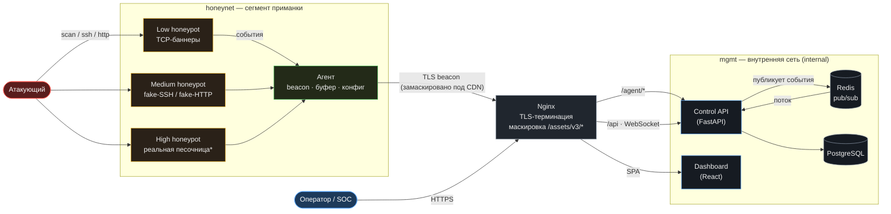
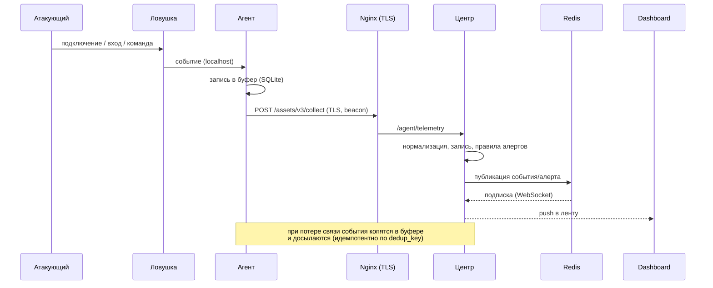

# HoneyForge — архитектура

## Компоненты и потоки

\* High honeypot — lab-only: реальные команды в одноразовой изолированной песочнице.

## Ключевые инварианты

- **MASK-1.** Телеметрия идёт только по TLS (терминация на Nginx :8443).
- **MASK-2.** Снаружи канал выглядит как обычный веб-ресурс: `/assets/v3/collect`,
  `/assets/v3/manifest.json`, `/assets/v3/register` — Nginx переписывает их во
  внутренние `/agent/*`. Никаких строк `honeypot`/`c2`.
- **MASK-3.** `mgmt` — internal-сеть: из `honeynet` **нет маршрута** к центру и БД.
  Мост — только Nginx, и только через замаскированный endpoint.
- **MASK-4.** Агент маскирует имя процесса (напр. `systemd-timesyncd`).
- Оператор не имеет прямого доступа к БД; агент не знает адреса центра/БД —
  только публичный замаскированный URL.

## Сценарий «атака → событие» (последовательность)

